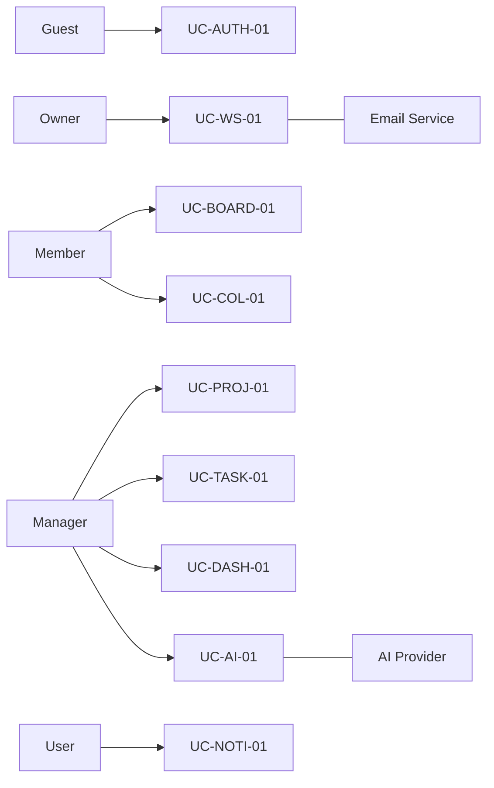

# Use Case Specification
**v0.1 | Draft**

Actor: Guest, User, Owner, Admin, Manager, Member; Email Service và AI Provider là external actors.

Sơ đồ actor–use case dạng Mermaid, không phải UML chuẩn ký pháp.

## UC-AUTH-01 — Đăng ký, đăng nhập, refresh, logout
- Actor: Guest / User
- Related: FR-AUTH-01
- Precondition: Không cần session khi đăng ký/đăng nhập.
- Main flow: Nhập email và password; hệ thống validate, tạo user hoặc xác thực; trả session.
- Alternative / exception: Email trùng 409; sai thông tin 401; refresh hết hạn yêu cầu login.
- Postcondition: Đăng nhập đúng trả token; sai trả 401.
- Rule: Email duy nhất; refresh token xoay vòng và thu hồi.

## UC-WS-01 — Tạo workspace, mời và quản lý thành viên
- Actor: Owner / Admin
- Related: FR-WS-01
- Precondition: Đã đăng nhập và có quyền phù hợp.
- Main flow: Owner tạo workspace; mời email; người nhận đăng nhập và chấp nhận token; tạo membership.
- Alternative / exception: Token hết hạn/đã dùng bị từ chối; email không khớp 403.
- Postcondition: Người được mời đúng email chấp nhận một lần.
- Rule: Owner cuối không được rời; lời mời hết hạn sau 48 giờ.

## UC-PROJ-01 — Tạo, cập nhật, lưu trữ project và quản lý thành viên
- Actor: Owner / Admin / Manager
- Related: FR-PROJ-01
- Precondition: Đã đăng nhập và có quyền phù hợp.
- Main flow: Owner/Admin tạo project và chỉ định Manager; Manager thêm thành viên workspace vào project.
- Alternative / exception: Không thuộc workspace: từ chối; project archived: không ghi.
- Postcondition: Manager tạo task trong project được cấp quyền.
- Rule: Project thuộc đúng workspace; project lưu trữ chỉ đọc.

## UC-TASK-01 — Tạo task, subtask, giao việc, deadline, priority
- Actor: Manager / Member
- Related: FR-TASK-01
- Precondition: Đã đăng nhập và có quyền phù hợp.
- Main flow: Manager nhập title, priority, assignee và deadline; validate; lưu task và audit; phát event.
- Alternative / exception: Assignee không hợp lệ 422; Member không có quyền tạo 403.
- Postcondition: Task được giao xuất hiện trong My Tasks.
- Rule: Assignee thuộc project; subtask cùng project; deadline hợp lệ.

## UC-BOARD-01 — Kanban, kéo thả và sắp xếp task
- Actor: Manager / Member
- Related: FR-BOARD-01
- Precondition: Đã đăng nhập và có quyền phù hợp.
- Main flow: Người dùng chọn task và vị trí mới; gửi status, position, version; backend cập nhật transaction; UI đồng bộ.
- Alternative / exception: Version cũ 409, tải lại board; Member chỉ được chuyển task của mình.
- Postcondition: Hai cập nhật đồng thời không ghi đè âm thầm.
- Rule: Kiểm tra version khi di chuyển; cập nhật thứ tự nguyên tử.

## UC-COL-01 — Bình luận, mention, đính kèm
- Actor: Manager / Member
- Related: FR-COL-01
- Precondition: Đã đăng nhập và có quyền phù hợp.
- Main flow: Member mở task, nhập comment hoặc upload; kiểm tra quyền và file; lưu; tạo notification mention.
- Alternative / exception: File quá lớn 413; loại file không hợp lệ 422.
- Postcondition: Bình luận hiển thị và người được mention nhận thông báo.
- Rule: Mention chỉ thành viên project; file tối đa 10 MB.

## UC-NOTI-01 — Thông báo trong app và real-time
- Actor: User
- Related: FR-NOTI-01
- Precondition: Đã đăng nhập và có quyền phù hợp.
- Main flow: User mở inbox; tải notification phân trang; đánh dấu đã đọc; nhận event mới.
- Alternative / exception: Mất kết nối: reconnect và tải lại; không đọc notification người khác.
- Postcondition: Reconnect tải lại thông báo chưa đọc.
- Rule: Chỉ người nhận đọc hoặc đánh dấu đã đọc.

## UC-DASH-01 — Dashboard tiến độ, My Tasks, audit log
- Actor: Manager / Member
- Related: FR-DASH-01
- Precondition: Đã đăng nhập và có quyền phù hợp.
- Main flow: User chọn project; backend tổng hợp task theo trạng thái và deadline; trả thống kê; Manager xem audit.
- Alternative / exception: Project không có task: trả số 0; không quyền 403/404.
- Postcondition: Số task hoàn thành khớp dữ liệu.
- Rule: Thống kê theo quyền; audit chỉ Owner/Admin/Manager trong phạm vi.

## UC-AI-01 — Sinh kế hoạch AI, chỉnh sửa và xác nhận
- Actor: Manager
- Related: FR-AI-01
- Precondition: Đã đăng nhập và có quyền phù hợp.
- Main flow: Manager nhập brief; backend tạo job; AI sinh JSON; validate; hiển thị draft; Manager sửa và xác nhận; transaction tạo task và audit.
- Alternative / exception: Timeout hoặc JSON sai: FAILED, không tạo task; xác nhận lặp trả kết quả cũ; mất quyền trước confirm: từ chối.
- Postcondition: JSON sai không tạo task; xác nhận hai lần không nhân đôi.
- Rule: Không tạo task trước xác nhận; xác nhận idempotent.
