# System Design
**v0.2 | Active Architecture (Clean Architecture)**

> **ADR liên quan:** [ADR-001: Áp dụng Feature-based Clean Architecture](architecture/decisions/ADR-001-adopt-clean-architecture.md)

---

## 1. Architecture Overview & Goals

FlowPilot AI áp dụng kiến trúc chính thức:

- **Architecture Style:** Modular Monolith.
- **Code Organization:** Feature-based Architecture.
- **Backend Internal Architecture:** Clean Architecture.
- **Design Principles:** SOLID, Dependency Inversion, Separation of Concerns.
- **Dependency Injection:** Constructor Injection và Composition Root (không dùng DI framework ngoài).
- **Frontend Architecture:** Feature-based Architecture (React + Vite + TypeScript).
- **Persistence:** Prisma ORM và PostgreSQL.
- **Communication:** REST API (hiện tại) và Socket.IO WebSocket (kế hoạch Sprint 4).
- **Deployment:** Single backend application + React SPA.

*(Redis, RabbitMQ và pgvector không bắt buộc cho MVP.)*

### Architecture Goals

1. **Business Logic Independence:** Tách biệt hoàn toàn nghiệp vụ (`Domain`, `Application`) khỏi framework và hạ tầng (`Express`, `Prisma`, `bcrypt`, `jose`).
2. **Testability:** Cho phép unit test Use Cases nhanh chóng bằng fake/in-memory Ports mà không cần PostgreSQL hay mock module internals.
3. **Module Isolation:** Mỗi feature module sở hữu ranh giới nghiệp vụ rõ ràng, giao tiếp qua public contracts (`index.ts`).
4. **Infrastructure Replaceability:** Dễ dàng thay thế adapter (AI provider, Storage, Email, Token service) mà không sửa Use Case.
5. **Practicality for Solo Developer:** Giữ sự đơn giản vận hành của Modular Monolith, tránh over-engineering của Microservices hay CQRS/Event Sourcing.

> **Lưu ý về đánh đổi:** Modular Monolith + Clean Architecture tương thích hoàn toàn vì Modular Monolith định nghĩa **ranh giới giữa các module nghiệp vụ** và **đơn vị triển khai**, còn Clean Architecture định nghĩa **hướng phụ thuộc bên trong từng module**. Clean Architecture **không** tự động yêu cầu Microservices và **không** cải thiện runtime performance; đổi lại, nó giảm coupling và chi phí bảo trì dài hạn với chi phí tăng nhẹ số lượng file (ports, adapters, presenters).

---

## 2. Architecture Diagrams

### 2.1 System Context Diagram

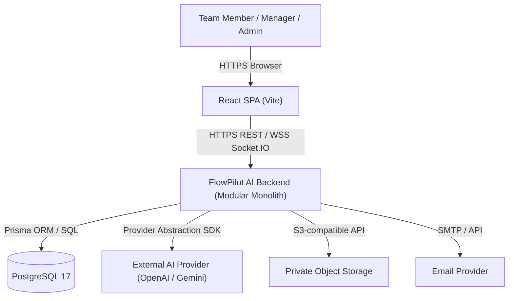

### 2.2 High-Level System Architecture

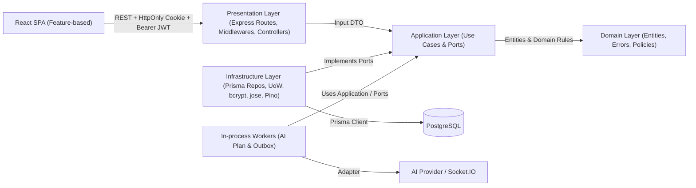

### 2.3 Modular Monolith Module Diagram

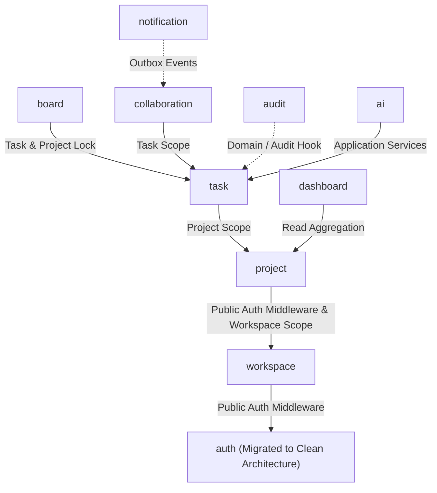

### 2.4 Clean Architecture Dependency Diagram

> **Phân biệt quan trọng:** Mũi tên dưới đây biểu diễn **hướng phụ thuộc source code (import)**, ngược chiều với luồng gọi thực thi (runtime execution flow).

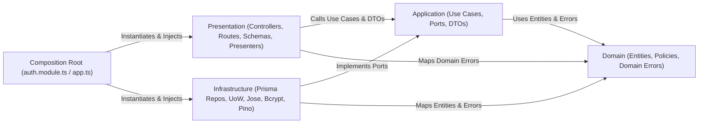

### 2.5 Authentication Module Component Diagram

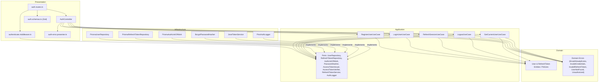

### 2.6 Registration Sequence Diagram

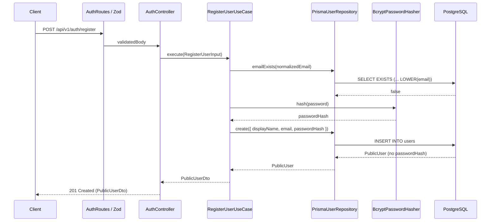

### 2.7 Login Sequence Diagram

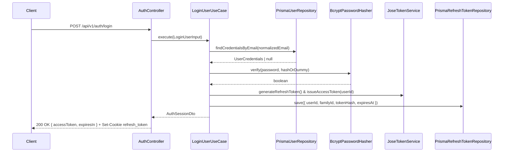

### 2.8 Refresh Token Rotation Sequence Diagram

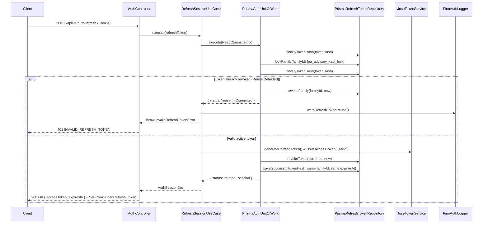

### 2.9 Logout Sequence Diagram

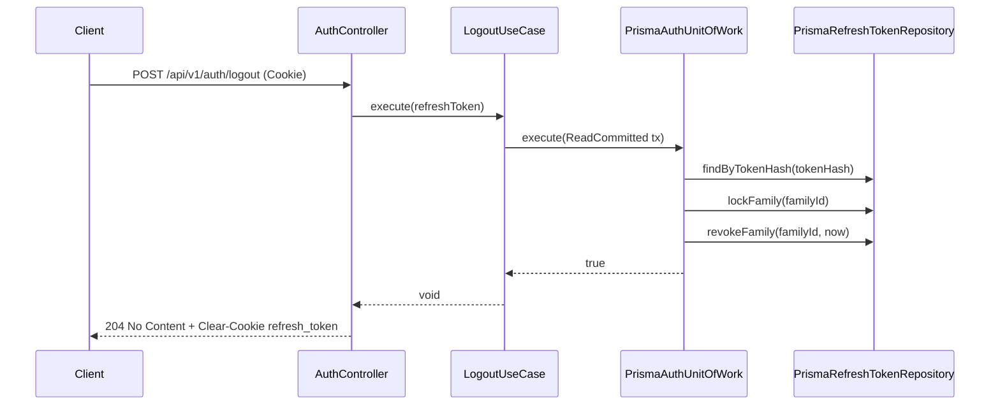

### 2.10 Get Current User Sequence Diagram

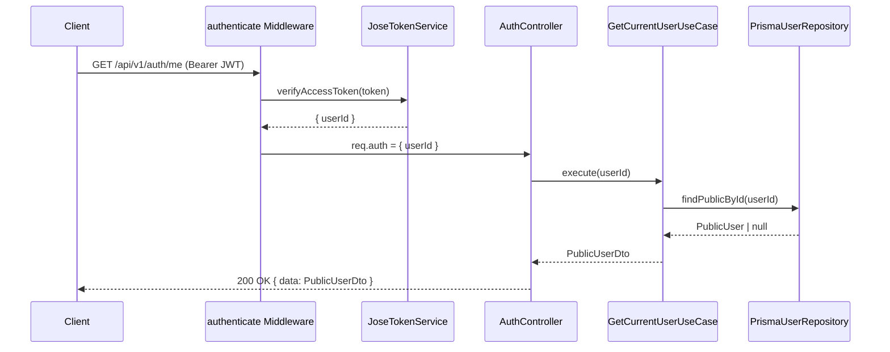

### 2.11 Dependency Injection & Composition Root Diagram

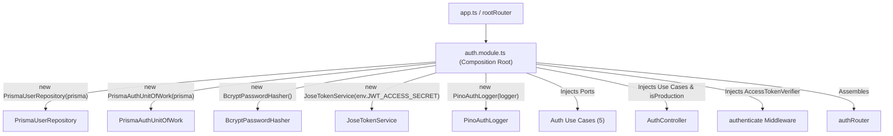

### 2.12 Deployment Diagram

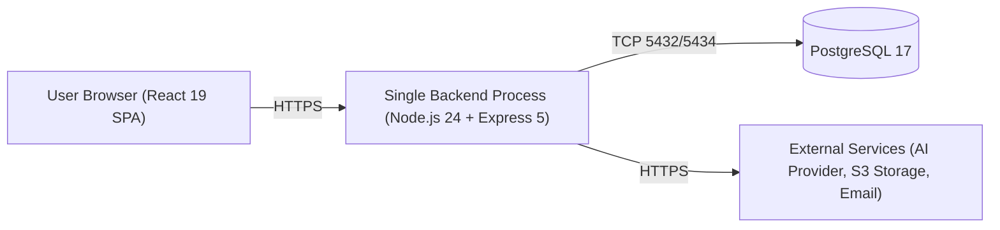

---

## 3. Clean Architecture Layers & Dependency Rule

1. **Domain Layer (`domain/`):**
   - Chứa Entities, Value Objects, Domain Policies/Helpers, Domain Errors (`DomainError`).
   - Pure TypeScript — **không** import Express, Prisma, bcrypt, jose, Pino hay `process.env`.
2. **Application Layer (`application/`):**
   - Chứa Use Cases, Input/Output DTOs, Ports (interfaces), Application Errors (`ApplicationError`).
   - Chỉ phụ thuộc vào `Domain` và `Ports` của chính nó. Không trả về HTTP status codes, không đọc cookies, không trả về raw Prisma models.
3. **Infrastructure Layer (`infrastructure/`):**
   - Implement các `Ports` bằng công nghệ cụ thể (Prisma, PostgreSQL, bcryptjs, jose, Pino).
   - Dịch lỗi hạ tầng (ví dụ Prisma `P2002` trên `users_email_lower_uidx`) thành Domain Error (`EmailAlreadyExistsError`).
4. **Presentation Layer (`presentation/`):**
   - Chứa Express Routes, Controllers, Zod Request Schemas, HTTP Middlewares, Error Presenters (`toAuthAppError`).
   - Map validated HTTP input → Application Input DTO → gọi Use Case → map Output DTO / DomainError → HTTP response.
5. **Composition Root (`<module>.module.ts` & `app.ts`):**
   - Nơi duy nhất khởi tạo concrete adapters và inject vào Use Cases, Controllers, và Middlewares qua Constructor Injection.

---

## 4. Target Backend Directory Structure & Module Boundaries

```text
backend/
├── prisma/
│   ├── schema.prisma
│   └── migrations/
├── tests/
│   ├── unit/                      # Domain & Use Case unit tests (in-memory fakes)
│   ├── integration/               # Supertest + PostgreSQL integration tests
│   ├── architecture/              # Automated Clean Architecture fitness tests
│   ├── fixtures/
│   └── helpers/
└── src/
    ├── shared/
    │   ├── domain/errors/         # DomainError, ERROR_CODES
    │   └── application/errors/    # ApplicationError
    ├── modules/
    │   ├── auth/                  # Migrated to Clean Architecture
    │   │   ├── domain/            # entities/, errors/
    │   │   ├── application/       # use-cases/, ports/, dtos/
    │   │   ├── infrastructure/    # repositories/, persistence/, security/, logging/
    │   │   ├── presentation/      # controllers/, routes/, middlewares/, schemas/, presenters/
    │   │   ├── auth.module.ts     # Composition Root
    │   │   └── index.ts           # Public Module Contract
    │   ├── workspace/             # Sprint 2 module (Layered; future migration candidate)
    │   ├── project/               # Sprint 2 module (Layered; future migration candidate)
    │   └── task/, board/, collaboration/, notification/, dashboard/, audit/, ai/
    ├── config/                    # env.ts, logger.ts, prisma.ts, cors.ts
    ├── middlewares/               # Shared HTTP middlewares (auth re-export, authorization, error, rate-limit, request-id, validation)
    ├── errors/                    # AppError (HTTP) + error-codes re-export
    ├── integrations/              # ai/, storage/, email/ provider adapters
    ├── sockets/                   # Socket.IO server & handlers
    ├── jobs/                      # In-process background workers
    ├── routes/                    # Root Express router
    ├── app.ts                     # Express app factory
    └── server.ts                  # HTTP server + graceful shutdown
```

### Module Boundaries & Cross-Module Rules

- Các module ngoài `auth` **chỉ** được import từ `modules/auth/index.ts` (hoặc qua `middlewares/auth.middleware.ts`), **tuyệt đối không** deep-import vào `domain/`, `application/`, `infrastructure/`, `presentation/`, hay `auth.module.ts`.
- **Naming Conventions:** `<Action><Entity>UseCase` (`RegisterUserUseCase`), `<Capability>Repository` / `<Capability>Port` (`user.repository.port.ts`), `Prisma<Entity>Repository`, `<Name>Controller`, `create<Module>Router`, `<module>.module.ts`.
- **Rules for Future Modules:** Mọi module mới từ Sprint 03 trở đi (`task`, `board`, `collaboration`, `notification`, `dashboard`, `audit`, `ai`) phải tuân thủ 4 tầng Clean Architecture + Composition Root.

---

## 5. Transaction Management & Error Handling

- **Transaction Management:** Các thao tác đa bước có yêu cầu tính nguyên tử và locking (như Refresh Token Rotation và Logout Revocation) sử dụng `AuthUnitOfWork` (`PrismaAuthUnitOfWork`) với `ReadCommitted` và `pg_advisory_xact_lock`. Tất cả repository calls trong transaction dùng chung transaction client (`tx`). Khi phát hiện reuse, transaction commit việc thu hồi family trước khi Use Case ném `InvalidRefreshTokenError` bên ngoài transaction.
- **Error Handling:**
  - `DomainError` / `ApplicationError` mang `code` và `message` (không mang HTTP status code).
  - `AuthController` + `toAuthAppError` ánh xạ lỗi nghiệp vụ sang `AppError` với HTTP status code đúng chuẩn OpenAPI.
  - `errorMiddleware` chuẩn hóa JSON `{ code, message, requestId }`, không rò rỉ stack trace, SQL, password hash, hay raw tokens.

---

## 6. Security, Persistence, Testing & Deployment

- **Security:** Access token JWT (HS256, TTL 15 phút, `at+jwt`, claims `sub`, `iat`, `exp`, `iss`, `aud`). Refresh token opaque 32-byte lưu SHA-256 trong PostgreSQL, cookie `HttpOnly`, `SameSite=Lax`, `Path=/api/v1/auth`, `Secure` ở production. Password hash bằng `bcryptjs` cost 12, giữ dummy hash cho timing mitigation.
- **Authorization:** Kiểm tra membership/role trực tiếp từ DB (`workspace_members`, `project_members`), không chỉ dựa vào JWT claims.
- **Testing Architecture:**
  - `tests/unit/`: Test Domain và Use Cases bằng in-memory fakes/stubs (không cần PostgreSQL).
  - `tests/integration/`: Test end-to-end HTTP + Prisma + PostgreSQL thật trên `flowpilot_ai_test`.
  - `tests/architecture/`: Automated fitness tests kiểm tra Dependency Rule, module boundaries, và circular dependencies.
- **Deployment & Scalability:** Single Node.js process + PostgreSQL 17. Khi cần scale ngang sau MVP, có thể bổ sung Redis adapter cho Socket.IO/rate-limit hoặc tách worker mà không cần đổi business logic trong Use Cases.
