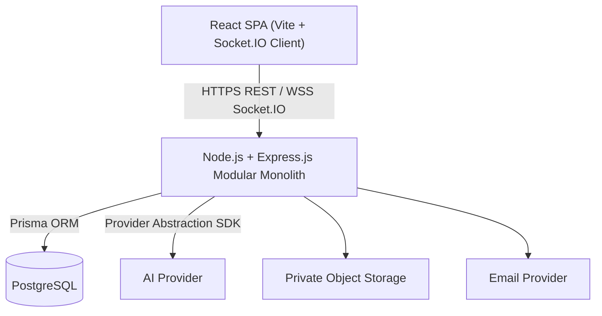
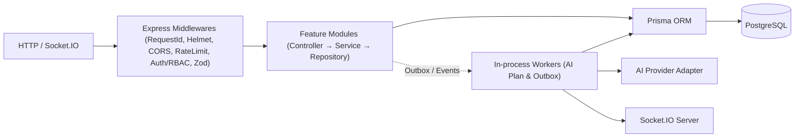
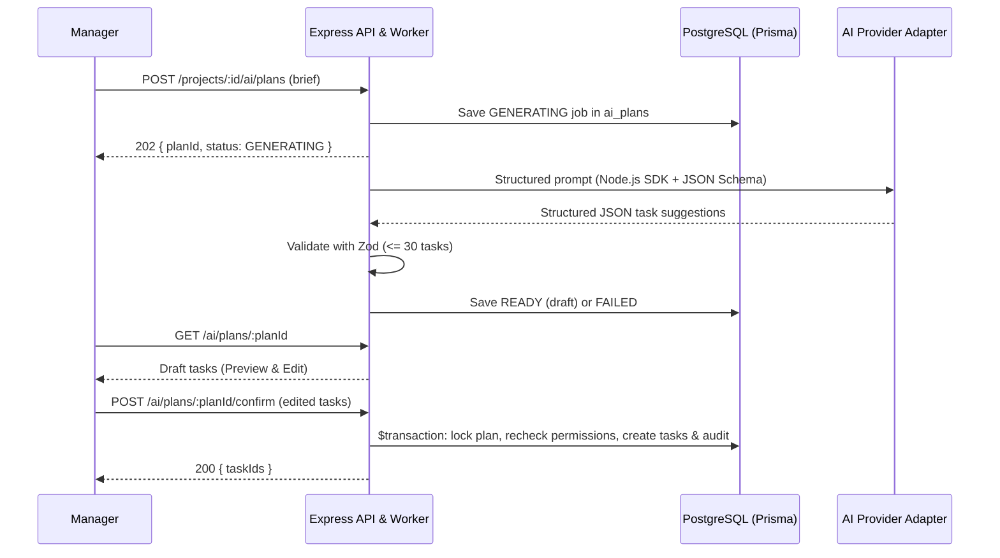

# System Design
**v0.1 | Draft**

## Architecture
- **Core Stack (chính thức):** React, Node.js LTS, Express.js, PostgreSQL (TypeScript end-to-end).
- **Frontend (đề xuất):** React, Vite, TypeScript, Tailwind CSS, shadcn/ui, React Router, TanStack Query, Zustand, React Hook Form, Zod, dnd-kit, Recharts, Socket.IO Client.
- **Backend (đề xuất):** Node.js LTS, Express.js, TypeScript, Prisma ORM, Prisma Migrate, Zod, JWT, bcrypt, Socket.IO, Helmet, CORS, `express-rate-limit`, Pino Logger.
- **Integrations:** AI Provider SDK cho Node.js theo hướng **Provider Abstraction** (dễ chuyển đổi giữa OpenAI, Gemini hoặc provider khác), S3-compatible private storage, email provider.
- **Architecture Style:** **Modular Monolith** theo **Feature-based Architecture** kết hợp **Layered Architecture**. Redis/RabbitMQ/pgvector không bắt buộc cho MVP. Chọn phiên bản package tương thích khi khởi tạo `package.json`.



### Component & Layer Flow
**Backend Request Flow:** `HTTP Request → Express Router → Middleware → Controller → Service → Repository → Prisma ORM → PostgreSQL`.



## Module boundaries & Backend Folder Structure
Luồng phụ thuộc nghiệp vụ: `Auth/User → Workspace → Project → Task/Board → Collaboration`; `Notification/Audit` nhận domain event qua transactional outbox hoặc service hook; `AI` gọi `Project/Task` application services, không truy cập repository của module khác trực tiếp. DTO / response mapper không expose raw Prisma model hay sensitive fields (`password_hash`, `token_hash`). Transaction (`prisma.$transaction`) đặt ở Service layer.

Cấu trúc thư mục Backend (`backend/`):
```text
backend/
├── prisma/
│   ├── schema.prisma
│   └── migrations/
├── tests/                     # Unit & Supertest integration tests
└── src/
    ├── config/                # Env validation (Zod), Pino logger, Prisma client, CORS
    ├── modules/               # auth, workspace, project, task, board, collaboration, notification, dashboard, audit, ai
    │   └── <feature>/         # routes, controller, service, repository, schema (Zod), types
    ├── middlewares/           # authenticateJwt, authorizeWorkspace/Project, validateRequest, rateLimiter, requestId, errorHandler
    ├── integrations/          # ai/ (AiProvider interface + adapters + FakeAiProvider), storage/, email/
    ├── sockets/               # Socket.IO server, handshake JWT auth, server-managed room handlers
    ├── jobs/                  # Polling workers cho ai_plans (lease) và outbox_events (retry/backoff)
    ├── utils/                 # Password/token hashing, pagination, magic-byte helpers
    ├── errors/                # AppError classes và error codes chuẩn hóa
    ├── app.ts                 # Express app setup và routing
    └── server.ts              # HTTP server, Socket.IO attach, workers và graceful shutdown
```
*(Giữ cấu trúc gọn cho dự án cá nhân; không thêm DI container, CQRS hay abstraction dư thừa.)*

## Security
- **Authentication:** Express Authentication Middleware. Access token (JWT, TTL 15 phút) giữ trong memory phía client; Refresh token (TTL 7 ngày) dùng `HttpOnly`, `Secure`, `SameSite` cookie. Refresh rotation lưu `token_hash` trong DB; phát hiện token reuse lập tức revoke toàn bộ `family_id`. Password hash bằng `bcrypt`.
- **Authorization (Workspace / Project / Resource):** Express Authorization Middleware và Service layer kiểm tra membership/role trực tiếp trong DB cho từng resource (`workspace_members`, `project_members`). **Không chỉ dựa vào role claim trong JWT** để quyết định quyền truy cập tài nguyên. Truy cập ngoài workspace trả `404`; thiếu quyền trong phạm vi trả `403`.
- **Input & HTTP Hardening:** Validate toàn bộ request body/query/params bằng `Zod`. Sử dụng `Helmet`, `CORS` allowlist, kiểm tra `Origin`/CSRF cho các cookie endpoints (`/auth/refresh`, `/auth/logout`), và `express-rate-limit` cho auth và AI endpoints.
- **Error Handling & Log Hygiene:** Global Error Handling Middleware trả JSON `{ code, message, requestId }` khớp OpenAPI `Error` schema, không lộ stack trace ở production. Cấu hình Pino `redact` để tuyệt đối không lưu hay ghi log password, access/refresh token, invitation token thô hoặc API keys.
- **File Security:** File lưu private trên S3-compatible storage, cấp short-lived signed URL sau khi kiểm tra quyền task/project; chỉ cho phép PDF/PNG/JPEG, tối đa 10 MB, kiểm tra MIME + file signature (magic bytes) và đổi tên object ngẫu nhiên.

### Token delivery và thời hạn phiên

Access token dùng HS256 với khóa ngẫu nhiên 32 byte, issuer `flowpilot-ai`, audience `flowpilot-ai-api` và các claims `sub`, `iat`, `exp`. Refresh token là opaque token 32 byte ngẫu nhiên. PostgreSQL lưu SHA-256 của token. Mỗi lần login mở một family với hạn tuyệt đối 7 ngày, rotation giữ nguyên hạn đó.

Login và Refresh gửi access token trong JSON và gửi refresh token qua cookie `refresh_token` có `HttpOnly`, `SameSite=Lax`, path `/api/v1/auth` và `Secure` trong production. Browser gửi credentials và Origin thuộc CORS allowlist. Triển khai frontend và API cùng site để cookie hoạt động theo cấu hình này.

## Real-time Communication (Socket.IO)
- Sử dụng **Socket.IO** trên HTTP server của Express để truyền tải sự kiện real-time.
- **Handshake Auth:** Middleware `io.use(...)` xác thực JWT Access Token khi client bắt tay kết nối; từ chối nếu token thiếu, hết hạn hoặc không hợp lệ.
- **Server-managed Rooms:** Sau khi xác thực, server tự động cho socket join room cá nhân `user:{userId}`. Khi client muốn theo dõi một project, server kiểm tra quyền membership trong DB rồi mới cho join room `project:{projectId}`. Client không được phép tự ý join hoặc subscribe room của user hay project khác.
- **Consistency:** Notification và real-time event chỉ được phát sau khi DB transaction commit (đọc từ `outbox_events`). Socket.IO chỉ là tín hiệu kích hoạt UI; REST API là nguồn dữ liệu chuẩn khi reconnect hoặc đồng bộ lại inbox/board.

## AI planning & Integration

- **Provider Abstraction:** Thiết kế `AiProvider` interface trong `src/integrations/ai/` bọc Node.js AI Provider SDK (có thể đổi OpenAI, Gemini hoặc provider khác qua config), kèm `FakeAiProvider` cho CI và test.
- **Async Job Execution (Node.js):** Giữ API `202 Accepted` không đồng bộ. In-process worker trong `src/jobs/` poll bảng `ai_plans` theo cơ chế lease (`lease_until`), bounded retry cho lỗi transient, timeout 60s; không cần Redis hay RabbitMQ trong MVP.
- **Validation & Guardrails:** Brief tối đa 8.000 ký tự; rate limit 5 lần tạo/người/giờ. Output từ AI bắt buộc qua **Structured Output / JSON Schema** và kiểm tra lại bằng **Zod** (tối đa 30 tasks: `title`, `description`, `priority`, `estimatedHours`, `dueDate` nullable).
- **Human-in-the-loop & No Direct DB Access:** AI không có tool ghi dữ liệu hay thực thi SQL; prompt injection không được mở rộng quyền hay truy cập tenant khác. Task chỉ được tạo khi Manager Preview, Edit và Confirm.
- **Idempotent Confirm & Error Handling:** Khi Confirm, validate lại payload bằng Zod; mở `prisma.$transaction`, khóa dòng `ai_plans` (`FOR UPDATE`), kiểm tra lại quyền Manager và trạng thái project, tạo tasks qua Task/Audit service và lưu `result_ids` + `CONFIRMED`. Nếu đã `CONFIRMED`, trả `result_ids` cũ để chống tạo trùng khi gọi lặp hoặc đồng thời. AI timeout, JSON sai schema, vượt 30 tasks, rate limit (429) hoặc provider failure sẽ đánh dấu `FAILED` kèm `error_code` và tạo 0 task.

## Reliability
- **Optimistic Concurrency Control:** Task có trường `version` tăng mỗi lần cập nhật; Prisma thực hiện conditional update (`where: { id, version }`). Khi di chuyển task trên Kanban, transaction khóa dòng `projects` (`SELECT ... FOR UPDATE`), kiểm tra `version` và cập nhật `position` nguyên tử; conflict trả `409 Conflict`.
- **Transactional Outbox:** `outbox_events` ghi cùng transaction với nghiệp vụ cho email và notification; worker poll với exponential backoff và giới hạn `attempts`; `event_id` dùng để deduplicate ở bảng `notifications`. Job quá hạn `lease_until` được worker reclaim và log lỗi.

## Deployment
- Monorepo `frontend/`, `backend/`, `docs/`.
- **Build & Runtime:** Node.js LTS và `npm`; **Prisma Migrate** (`prisma migrate deploy`) chạy trước mỗi release; Docker ở trạng thái Optional.
- **CI/CD (GitHub Actions):** Chạy lint, typecheck (`tsc --noEmit`), Vitest/Supertest/RTL tests trên PostgreSQL test DB, build frontend/backend, smoke test trên staging, và manual approval trước khi deploy production.
- **Health & Observability:** Express Health Check endpoint (`GET /health` kiểm tra app & kết nối PostgreSQL); **Pino** structured JSON logging kèm `requestId` trên mọi log.
- **Environment Variables:** Quản lý qua biến môi trường (`NODE_ENV`, `PORT`, `DATABASE_URL`, `JWT_ACCESS_SECRET`, `CORS_ORIGIN`, `AI_PROVIDER`, `AI_API_KEY`, `AI_TIMEOUT_MS`, `S3_ENDPOINT`, `S3_BUCKET`, `S3_ACCESS_KEY`, `S3_SECRET_KEY`, `EMAIL_API_KEY`, `LOG_LEVEL`). Backup/restore PostgreSQL định kỳ. Hosting chưa chốt.

## Decisions
Modular Monolith giảm overhead cho solo developer; Node.js + Express.js + TypeScript đồng nhất ngôn ngữ với React frontend; Prisma ORM + PostgreSQL giữ nguyên tính chặt chẽ về transaction/constraints và hỗ trợ custom SQL migrations; DB job/outbox thay message broker cho MVP; AI Provider Abstraction tránh vendor lock-in; Human-in-the-loop approval giảm rủi ro tạo task sai. Đánh đổi: chưa scale ngang worker hoặc real-time adapter chuyên dụng (có thể bổ sung Redis adapter/queue sau MVP nếu cần).
