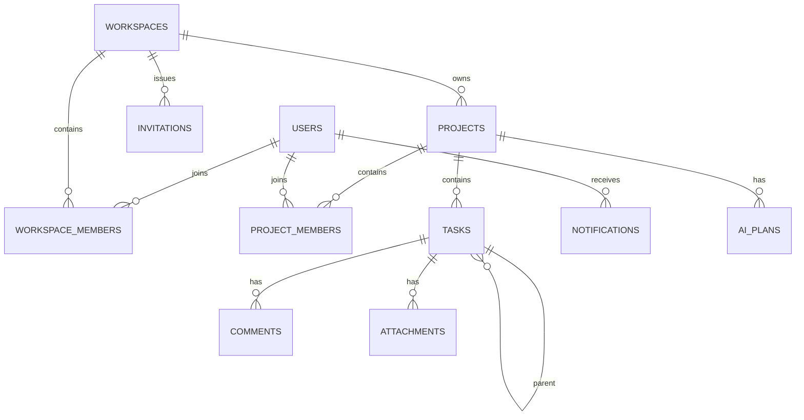

# Database Design — PostgreSQL & Prisma ORM
**v0.1 | Draft**

## Data dictionary
UUID PK mặc định (`uuid` / `@db.Uuid`); timestamps `timestamptz` UTC; FK NOT NULL trừ khi ghi nullable. Các enum dùng PostgreSQL enum hoặc `CHECK` constraint trong migration. Mọi bảng có `created_at`; bảng mutable có `updated_at`.
| Table | Columns chính (ngoài id, timestamps) | Constraints / indexes |
|---|---|---|
| users | email, password_hash, display_name | unique lower(email) |
| refresh_tokens | user_id, token_hash, family_id, expires_at, revoked_at nullable | unique token_hash |
| workspaces | name | name not blank |
| workspace_members | workspace_id, user_id, role | unique(workspace_id,user_id) |
| invitations | workspace_id, email, token_hash, role, status, expires_at | unique token_hash; partial unique pending email/workspace |
| projects | workspace_id, name, status | index(workspace_id,status) |
| project_members | project_id, user_id, role | unique(project_id,user_id) |
| tasks | project_id, parent_id nullable, assignee_id nullable, title, description, status, priority, due_date nullable, estimated_hours nullable, position, version | index(project_id,status,position); index(assignee_id,status); version >=0 |
| comments | task_id, author_id, body | index(task_id,created_at) |
| attachments | task_id, uploader_id, object_key, filename, mime_type, size_bytes | unique object_key |
| notifications | user_id, event_id, type, payload jsonb, read_at nullable | unique(user_id,event_id,type); index(user_id,read_at) |
| audit_logs | workspace_id, project_id nullable, actor_id, action, resource_id, metadata jsonb | index(workspace_id,created_at) |
| ai_plans | project_id, requested_by, brief, status, draft jsonb nullable, result_ids jsonb nullable, error_code nullable, lease_until nullable, attempts | index(status,lease_until) |
| outbox_events | event_type, payload jsonb, status, attempts, next_attempt_at | index(status,next_attempt_at) |

### Quy ước triển khai Authentication

- Tầng ứng dụng chuẩn hóa email bằng cách bỏ khoảng trắng hai đầu và chuyển sang chữ thường khi đăng ký hoặc tra cứu. PostgreSQL chặn email trùng khác hoa thường bằng unique index trên `LOWER(email)`. Prisma không cung cấp `findUnique` theo email với index biểu thức này.
- `refresh_tokens.family_id` là UUID dùng chung cho các token trong cùng một chuỗi rotation. Giữ bản ghi đã thu hồi trong thời gian cần phát hiện reuse. Index trên `family_id` hỗ trợ thu hồi cả chuỗi, `user_id` hỗ trợ truy vấn token của người dùng và `expires_at` hỗ trợ tìm token hết hạn.
- FK `refresh_tokens.user_id` dùng `ON DELETE RESTRICT` để yêu cầu xử lý bản ghi token trước khi xóa user, và `ON UPDATE CASCADE` để duy trì liên kết khi khóa thay đổi.

## Integrity, Transactions & Concurrency Control (Prisma ORM)
- **Domain Integrity:** Project membership phải thuộc workspace membership; assignee phải là project member (hoặc Owner/Admin có quyền và được thêm project member). Parent task cùng project, chỉ một cấp subtask MVP. Không hard-delete project trong MVP. Xóa membership phải gỡ assignment hoặc từ chối nếu còn task đang giao; lựa chọn MVP: từ chối. Không cascade xóa audit. File upload thất bại DB cần cleanup object trên S3.
- **Prisma Transactions:** Mọi thao tác nhiều bản ghi dùng interactive transaction `prisma.$transaction(async (tx) => { ... })` (ví dụ: tạo workspace kèm owner membership, confirm AI plan tạo hàng loạt task + audit log + outbox event, transfer ownership có khóa dòng workspace).
- **Optimistic Concurrency Control:** Bảng `tasks` giữ cột `version integer NOT NULL DEFAULT 0`. Khi update task, Prisma thực hiện conditional update `tx.task.updateMany({ where: { id, projectId, version: expectedVersion }, data: { ..., version: { increment: 1 } } })`. Nếu `count === 0` khi task vẫn tồn tại trong phạm vi quyền, service rollback transaction và trả `409 Conflict`.
- **Board Move Locking:** Khi di chuyển task trên Kanban, thực hiện trong `prisma.$transaction` bằng cách khóa dòng project qua `tx.$queryRaw` (`SELECT id FROM projects WHERE id = $1 FOR UPDATE`), xác minh `version` của task, cập nhật lại `position` các task bị ảnh hưởng và tăng `version` nguyên tử.
- **AI Plan Confirm Locking:** Khóa dòng `ai_plans` bằng `SELECT ... FOR UPDATE` trong `prisma.$transaction`; nếu `status === 'CONFIRMED'` trả ngay `result_ids` đã lưu (idempotent).

## Migration (Prisma Migrate & Custom SQL)
- Quản lý schema bằng `prisma/schema.prisma` và **Prisma Migrate** (`prisma/migrations/`), chạy theo các milestone tương ứng từng sprint:
  1. `init_auth`: `users`, `refresh_tokens`
  2. `workspace_invitations`: `workspaces`, `workspace_members`, `invitations`
  3. `project_task`: `projects`, `project_members`, `tasks`
  4. `collaboration_notification_audit_outbox`: `comments`, `attachments`, `notifications`, `audit_logs`, `outbox_events`
  5. `ai_plans`: `ai_plans`
- **Custom SQL Migrations:** Với các constraint/index PostgreSQL mà `schema.prisma` chưa hỗ trợ biểu diễn trực tiếp, tạo migration bằng `prisma migrate dev --create-only` và bổ sung SQL thuần vào `migration.sql`:
  - Functional unique index: `CREATE UNIQUE INDEX users_email_lower_uidx ON users (LOWER(email));`
  - Partial unique index cho lời mời đang chờ: `CREATE UNIQUE INDEX invitations_pending_uidx ON invitations (workspace_id, LOWER(email)) WHERE status = 'PENDING';`
  - `CHECK` constraints: `tasks_version_non_negative (version >= 0)`, `workspaces_name_not_blank (LENGTH(BTRIM(name)) > 0)`.
  - Composite Foreign Keys đảm bảo `parent_id` / `assignee_id` cùng `project_id` khi triển khai ràng buộc ở tầng DB.
- Đây là logical schema và thiết kế migration, chưa phải `schema.prisma` hay SQL migration chạy được; hoàn thiện DDL theo từng sprint.
