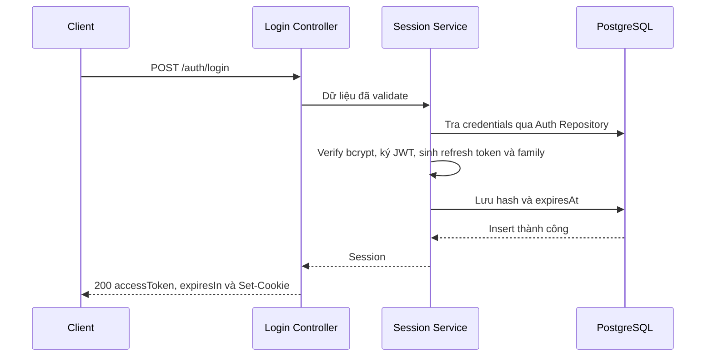
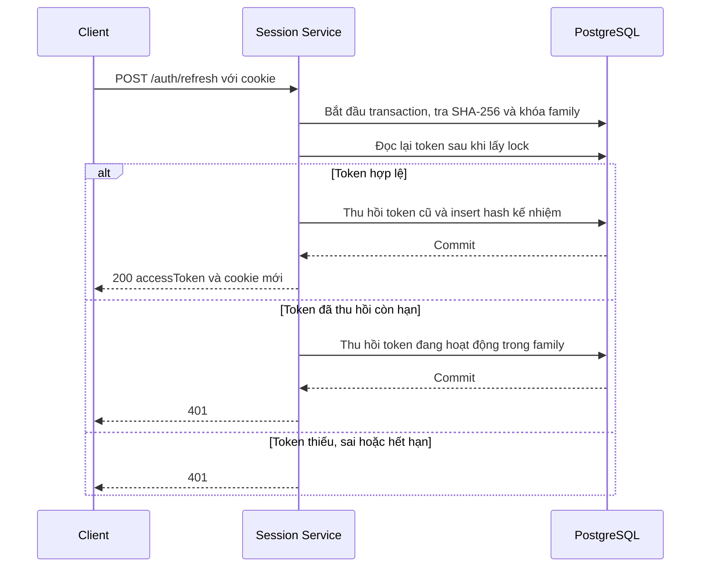

# AUTH-04 — Access Token & Refresh Token Management

## 1. Thông tin Task

- Task ID — AUTH-04
- Sprint — 1, Foundation + AUTH
- Ngày triển khai — 2026-11-25
- Trạng thái — PARTIAL
- Yêu cầu liên quan — `FR-AUTH-01`, `NFR-02`, `NFR-07`, `UC-AUTH-01`
- Loại báo cáo — Ghi sau triển khai

## 2. Tóm tắt triển khai

Đã mount `POST /api/v1/auth/login` và `POST /api/v1/auth/refresh`. Cả hai trả HTTP 200 với `accessToken` và `expiresIn`. Refresh token được gửi qua cookie. Cả AUTH-03 và AUTH-04 còn chờ kiểm chứng PostgreSQL test.

## 3. File thay đổi

| File | Action | Description |
|---|---|---|
| `backend/src/modules/auth/auth.tokens.ts` | Tạo | Ký và verify JWT bằng JOSE, sinh opaque token và băm SHA-256 |
| `backend/src/modules/auth/auth.session.ts` | Tạo | Login session, rotation, reuse và transaction |
| `backend/src/modules/auth/refresh-token.repository.ts` | Tạo | Truy vấn, ghi, thu hồi token và khóa family |
| `backend/src/modules/auth/auth.controller.ts`, `backend/src/modules/auth/auth.routes.ts` | Cập nhật | Controller, cookie, Origin và route |
| `backend/src/config/env.ts`, `backend/src/config/cors.ts`, `backend/src/errors/error-codes.ts`, `backend/src/middlewares/rate-limit.middleware.ts` | Cập nhật | Validation khóa, Origin allowlist, mã lỗi và rate limit |
| `backend/package.json`, `backend/package-lock.json`, `backend/.env.example` | Cập nhật | JOSE và cấu hình khóa |
| `backend/tests/unit/auth.tokens.test.ts`, `backend/tests/integration/auth.session.integration.test.ts`, `backend/tests/integration/auth.session.postgres.test.ts` | Tạo | JWT, HTTP với repository mock và kiểm chứng PostgreSQL |
| `backend/tests/setup.ts` | Cập nhật | Khóa ngẫu nhiên riêng cho test |
| `README.md`, `docs/04-System-Design.md`, `docs/07-Backlog-Roadmap.md`, `docs/reports/README.md`, `docs/reports/01-authentication/AUTH-03-user-login.md` | Cập nhật | Cấu hình, quyết định và tiến độ |

## 4. Quyết định kỹ thuật

- Access token là JWT HS256 có hạn 900 giây. JOSE verify chữ ký, thuật toán, token type, issuer, audience và claims `sub`, `iat`, `exp`. `JWT_ACCESS_SECRET` bắt buộc là khóa ngẫu nhiên 32 byte dạng hex và được validate khi khởi động.
- Refresh token là giá trị base64url từ 32 byte CSPRNG. SHA-256 của token được lưu cùng UUID family. Hạn tuyệt đối 7 ngày tính từ Login, được giữ nguyên qua rotation.
- Cookie `refresh_token` dùng `HttpOnly`, `SameSite=Lax`, path `/api/v1/auth` và `Secure` ở production. Frontend và API cần cùng site với lựa chọn này. Browser Origin phải thuộc allowlist, còn client trực tiếp như Postman có thể gọi qua cookie jar. Login giới hạn 15 và Refresh 30 request/phút/IP.
- PostgreSQL advisory transaction lock tuần tự hóa thay đổi cùng family. Transaction đọc lại bản ghi sau lock ở mức Read Committed. Reuse trả kết quả từ transaction để commit thu hồi trước khi service trả 401 và ghi security event không định danh. Hai tab dùng cùng token có thể làm cả family bị thu hồi, vì vậy frontend cần điều phối single-flight refresh giữa các tab. Access JWT đã cấp có hiệu lực đến khi hết hạn.
- Lỗi xác thực refresh dùng cùng HTTP 401. Lỗi DB trả HTTP 500 chung. Bản ghi đã thu hồi được giữ để phát hiện reuse tới khi hết hạn.

### Login

### Rotation và reuse

## 5. Kết quả kiểm chứng

| Check | Command or Evidence | Status |
|---|---|---|
| JWT và HTTP với repository mock | `npm run test`, 19 test mới đạt | PASSED |
| Regression | Tổng 48 test đạt, 7 test PostgreSQL skip | PASSED |
| PostgreSQL | 5 test AUTH-04 và 2 test Register chờ `TEST_DATABASE_URL` riêng | BLOCKED |
| Build, lint, typecheck | `npm run build`, `npm run lint`, `npm run typecheck` | PASSED |
| Backend thật | Khóa sai bị từ chối, health 200/database up, Register 400 khi thiếu field, Refresh 401 khi thiếu cookie, Login 429 ở lần thử thứ 16 | PASSED |

## 6. Acceptance Criteria

| Criterion | Status | Notes |
|---|---|---|
| AC-01, AC-02, AC-03 | PASSED | Unit test JWT, claim validation và opaque token |
| AC-04 | BLOCKED | HTTP mock xác nhận repository nhận hash. PostgreSQL thực tế chưa kiểm chứng. |
| AC-05, AC-06 | BLOCKED | HTTP contract đã qua test mock. Luồng thành công với PostgreSQL chưa chạy. |
| AC-07, AC-08, AC-09, AC-10 | BLOCKED | Logic đã qua test mock. Cần xác nhận trạng thái token và family trong PostgreSQL. |
| AC-11, AC-12, AC-13 | BLOCKED | Commit reuse, concurrency và rollback chờ PostgreSQL test. |
| AC-14 | PASSED | Unit và HTTP mock kiểm tra expiry, rotation giữ nguyên hạn |
| AC-15, AC-16, AC-17 | PASSED | Khóa sai bị từ chối, chỉ trả dữ liệu qua kênh quy định, test JWT và HTTP mock đạt |
| AC-18 | BLOCKED | PostgreSQL integration chưa chạy |
| AC-19, AC-20 | PASSED | Regression hiện có, smoke, health, build, lint và typecheck đạt. Hai test Register ghi DB vẫn skip. |
| AC-21, AC-22 | PASSED | Đã lưu báo cáo, thay đổi trong phạm vi Login và token management |

## 7. Vấn đề và blocker

Cần PostgreSQL test riêng có tên kết thúc bằng `_test` và đã áp dụng migrations, sau đó chạy `npm run test` với `TEST_DATABASE_URL` trong shell. Development database chỉ được dùng để kiểm tra kết nối. Cần xác nhận frontend và API triển khai cùng site khi chốt hosting.

## 8. Ghi chú cho developer

Access token cấp quyền ngắn hạn, refresh token đổi phiên và token family nhóm các lần rotation của một lần login. Review [Session Service](../../../backend/src/modules/auth/auth.session.ts) và [Refresh Token Repository](../../../backend/src/modules/auth/refresh-token.repository.ts) để thấy ranh giới transaction.

**Postman trên môi trường test.** Dùng tài khoản fixture. Gửi JSON có `email` và `password` đến `POST /api/v1/auth/login`, kỳ vọng 200, JSON có `accessToken`, `expiresIn: 900` và cookie. Bật cookie jar và gửi `POST /api/v1/auth/refresh` không body. Kỳ vọng 200 và cookie mới. Gửi lại cookie cũ trên một phiên kiểm thử riêng để kiểm tra 401 và thu hồi family đó.

## 9. Task tiếp theo

Kiểm chứng AUTH-03 và AUTH-04 trên PostgreSQL test, sau đó chuyển sang AUTH-05 khi được giao.
