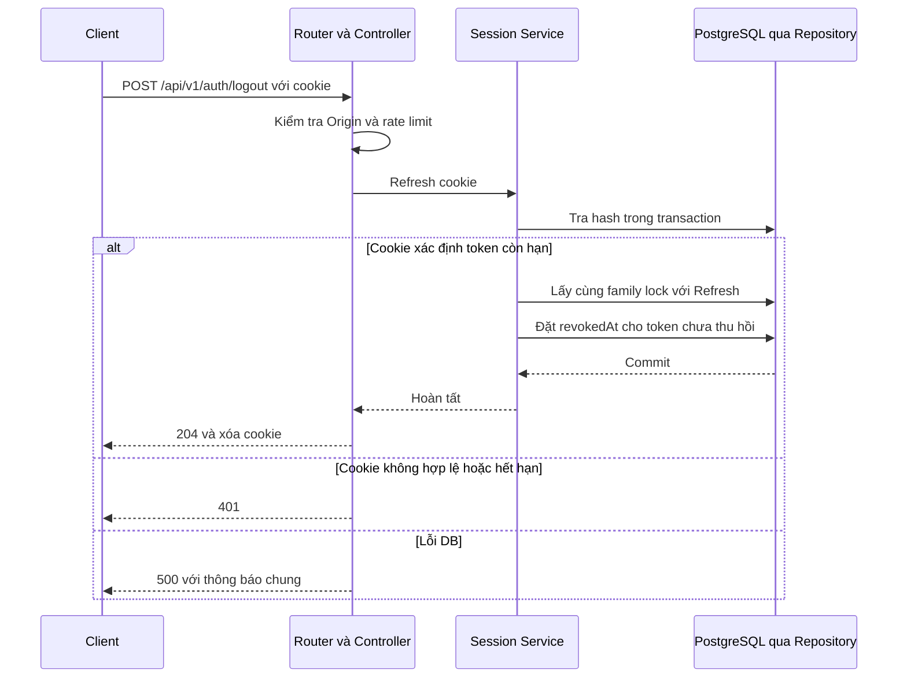

# AUTH-05 — Logout & Token Revocation

## 1. Thông tin Task

- Task ID — AUTH-05
- Tên Task — Logout & Token Revocation
- Sprint — 1, Foundation + AUTH
- Ngày triển khai — 2026-11-25
- Trạng thái — PARTIAL
- Yêu cầu liên quan — `FR-AUTH-01`, `NFR-02`, `NFR-07`, `UC-AUTH-01`
- Loại báo cáo — Ghi sau triển khai, dựa trên test và kiểm tra HTTP thực tế

## 2. Tóm tắt triển khai

`POST /api/v1/auth/logout` dùng cookie `refresh_token` để nhận diện phiên hiện tại. Endpoint trả `204 No Content` và xóa cookie sau khi transaction thu hồi family hoàn tất. Cookie thiếu, sai định dạng, không tìm thấy hoặc hết hạn đều trả `401 INVALID_REFRESH_TOKEN`.

## 3. File thay đổi

| File | Action | Description |
|---|---|---|
| `backend/src/modules/auth/auth.session.ts` | Cập nhật | Logic logout, xác thực cookie dùng chung với Refresh và transaction thu hồi family |
| `backend/src/modules/auth/auth.controller.ts` | Cập nhật | Logout controller và cấu hình cookie dùng chung khi tạo hoặc xóa |
| `backend/src/modules/auth/auth.routes.ts`, `backend/src/middlewares/rate-limit.middleware.ts` | Cập nhật | Route Logout với kiểm tra Origin và rate limit |
| `backend/tests/unit/auth.logout.test.ts` | Tạo | Kiểm tra lock và chờ transaction hoàn tất |
| `backend/tests/integration/auth.session.integration.test.ts`, `backend/tests/integration/auth.session.postgres.test.ts` | Cập nhật | Kiểm thử HTTP với mock và các ca PostgreSQL |
| `docs/reports/README.md`, `docs/07-Backlog-Roadmap.md` | Cập nhật | Tiến độ |

## 4. Quyết định kỹ thuật

- Logout kết thúc family được tìm theo SHA-256 của refresh cookie. Chỉ dữ liệu đọc từ PostgreSQL quyết định family cần thu hồi. `revokedAt` được cập nhật cho các token chưa thu hồi và các bản ghi lịch sử được giữ cho reuse detection.
- Token đã rotate hoặc đã logout vẫn có thể xác định family trong thời hạn của token. Gửi lại cùng cookie đã biết và còn hạn trả `204`. Sau khi cookie bị xóa, lần gọi thiếu cookie trả `401` theo yêu cầu refresh cookie của OpenAPI.
- Logout và Refresh dùng cùng advisory transaction lock. Nếu Refresh tạo token kế nhiệm trước, Logout sẽ thu hồi token đó. Nếu Logout thu hồi trước, Refresh đọc lại trạng thái sau khi lấy lock và trả `401`.
- Cookie được xóa với cùng path `/api/v1/auth`, host-only, `HttpOnly`, `SameSite=Lax` và `Secure` ở production. Route giữ kiểm tra Origin/CSRF và giới hạn 30 request/phút/IP. Lỗi DB trả `500 INTERNAL_ERROR` và giữ cookie để có thể thử lại.
- Cookie clearing xóa credential phía trình duyệt. Thu hồi refresh token chặn trao đổi token đó. Thu hồi family chặn toàn bộ chuỗi token của phiên. JWT đã cấp vẫn có hiệu lực đến khi hết hạn 15 phút theo thiết kế stateless hiện tại.

## 5. Kết quả kiểm chứng

| Check | Command or Evidence | Status |
|---|---|---|
| Unit và HTTP với mock | 10 test Logout mới đạt | PASSED |
| Regression | `npm run test`, 58 đạt và 10 PostgreSQL test bị skip | PASSED |
| Build, lint, typecheck | `npm run build`, `npm run lint`, `npm run typecheck` | PASSED |
| Backend đã build | Health 200/database up, Logout 401 khi thiếu cookie, request thứ 31 trả 429 | PASSED |
| PostgreSQL Logout | 3 test về phạm vi family, concurrency và rollback chờ test database riêng | BLOCKED |

## 6. Acceptance Criteria

| Criterion | Status | Notes |
|---|---|---|
| AC-01 | PASSED | Route cookie đúng hợp đồng, HTTP mock trả 204 không body |
| AC-02, AC-03, AC-04, AC-05 | BLOCKED | Mock xác nhận chỉ dùng family từ cookie. Trạng thái thực tế và phiên độc lập chờ PostgreSQL. |
| AC-06, AC-07 | PASSED | HTTP mock kiểm tra lặp lại, cookie thiếu và thuộc tính cookie xóa |
| AC-08 | BLOCKED | JWT verification unit đã qua, ca phát hành và verify JWT sau Logout chờ PostgreSQL. |
| AC-09, AC-10 | BLOCKED | Unit kiểm tra thứ tự lock và đợi transaction. Concurrency và rollback thật chưa chạy. |
| AC-11, AC-12 | PASSED | HTTP kiểm tra lỗi chung, cookie lỗi, Origin và rate limit |
| AC-13 | PASSED | Unit và HTTP mock đạt |
| AC-14 | BLOCKED | 3 test PostgreSQL Logout chưa chạy |
| AC-15, AC-16 | PASSED | Regression hiện có, build, lint, typecheck và smoke đạt. Regression ghi DB vẫn skip. |
| AC-17, AC-18 | PASSED | Báo cáo đã lưu và thay đổi trong phạm vi Logout |

## 7. Vấn đề và blocker

Chưa có `TEST_DATABASE_URL` trỏ đến PostgreSQL test riêng có tên kết thúc bằng `_test` và đã áp dụng migrations. Development database chỉ được dùng để kiểm tra kết nối.

## 8. Ghi chú cho developer

Review [Session Service](../../../backend/src/modules/auth/auth.session.ts) và [Controller](../../../backend/src/modules/auth/auth.controller.ts) để theo dõi ranh giới commit và việc xóa cookie.

**Postman trên môi trường test.** Login bằng tài khoản fixture để cookie jar nhận `refresh_token`. Gọi `POST /api/v1/auth/logout` không body và kiểm tra `204` cùng header xóa cookie. Gọi Refresh sau Logout và kỳ vọng `401`. Để kiểm tra revocation phía server, gửi lại cookie cũ trong phiên test riêng và xác nhận Refresh vẫn trả `401`.

## 9. Task tiếp theo

Chạy PostgreSQL integration suite trên test database đã xác nhận. AUTH-06 sẽ bắt đầu khi được giao.
