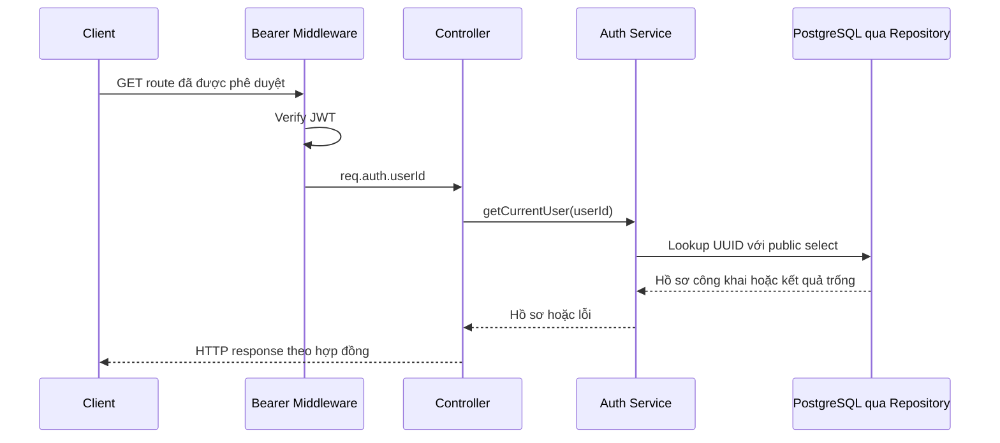

# AUTH-07 — Get Current User API

**Nghiệm thu 2026-11-26 — COMPLETED.** Đã chốt và cập nhật OpenAPI cho `GET /api/v1/auth/me`. HTTP PostgreSQL integration xác nhận đúng envelope, verified subject, 401 và 404. Edge xác nhận frontend hiển thị hồ sơ sau Login và reload. Các ghi chú blocker bên dưới là lịch sử trước khi chốt hợp đồng.

**Cập nhật AUTH-INT-01 ngày 2026-11-26 — PARTIAL.** Login → verify JWT → lookup theo UUID đã chạy trên PostgreSQL, gồm cả subject có user và subject không có user. AC-04 đã đạt ở lớp truy vấn. Route, response HTTP và các ca truy cập qua middleware còn chờ hợp đồng OpenAPI. Các bảng bên dưới ghi lại kết quả tại phiên AUTH-07 ban đầu. Xem [bằng chứng integration](AUTH-INT-01-integration-testing.md).

## 1. Thông tin Task

- Task ID — AUTH-07
- Tên Task — Get Current User API
- Sprint — 1, Foundation + AUTH
- Ngày triển khai — 2026-11-25
- Trạng thái — COMPLETED
- Yêu cầu liên quan — `BR-04`, Bearer Authentication trong System Design và yêu cầu AUTH-07
- Loại báo cáo — Ghi sau triển khai

## 2. Tóm tắt triển khai

Đã triển khai service và Prisma lookup nội bộ theo User ID. OpenAPI hiện có `/me/tasks` và chưa định nghĩa Get Current User. Controller, route và response envelope chờ xác nhận. Backend hiện trả 404 cho URL đề xuất.

## 3. File thay đổi

| File | Action | Description |
|---|---|---|
| `backend/src/modules/auth/auth.repository.ts` | Cập nhật | Prisma lookup theo UUID và public select dùng chung với Register |
| `backend/src/modules/auth/auth.service.ts` | Cập nhật | Lookup hồ sơ, kết quả thiếu user và lỗi DB an toàn |
| `backend/tests/unit/auth.current-user.test.ts` | Tạo | Kiểm tra Prisma query, select và lỗi |
| `backend/tests/integration/auth.session.postgres.test.ts` | Cập nhật | Ca tra cứu theo verified subject trên PostgreSQL test |
| `docs/reports/README.md`, `docs/07-Backlog-Roadmap.md` | Cập nhật | Trạng thái và blocker |

## 4. Quyết định kỹ thuật

Repository dùng `findUnique` theo UUID primary key. Internal projection gồm `id`, `email`, `displayName`, `createdAt`, `updatedAt`. Service phân biệt không tìm thấy record với lỗi truy vấn. Public envelope và HTTP contract chờ xác nhận.

Luồng dự kiến sau khi chốt hợp đồng:

## 5. Kết quả kiểm chứng

| Check | Command or Evidence | Status |
|---|---|---|
| Lookup nội bộ | 3 unit test xác nhận query UUID, projection, not found và lỗi DB | PASSED |
| PostgreSQL lookup | Ca kiểm tra verified subject và user không tồn tại chờ `TEST_DATABASE_URL` | BLOCKED |
| API và Postman | OpenAPI chưa có endpoint, request thử URL đề xuất hiện trả 404 | BLOCKED |

## 6. Acceptance Criteria

| Criterion | Status | Notes |
|---|---|---|
| AC-01–03 | BLOCKED | Chờ hợp đồng và tích hợp middleware vào route |
| AC-04 | BLOCKED | Query đã qua unit test, PostgreSQL chưa chạy |
| AC-05–06 | BLOCKED | Kiểm chứng cách ly danh tính và envelope chờ route |
| AC-07–08 | PASSED | Internal projection và xử lý not found đã qua unit test |
| AC-09 | BLOCKED | Chờ hợp đồng lỗi HTTP |
| AC-10 | PASSED | 3 unit test đạt |
| AC-11–12 | BLOCKED | Chờ route và PostgreSQL test riêng |

## 7. Vấn đề và blocker

Cần xác nhận method, path, response envelope và lỗi. Phương án đề xuất là `GET /api/v1/auth/me`, Bearer JWT, HTTP 200 với `{ data: { id, email, displayName, createdAt, updatedAt } }`, 401 nếu token không hợp lệ và 404 nếu subject hợp lệ nhưng user không tồn tại. Đây là đề xuất, chưa phải hợp đồng đang có hiệu lực. Cần PostgreSQL test riêng đã áp dụng migration.

## 8. Ghi chú cho developer

Trong Postman, chọn `GET /api/v1/auth/me` và Bearer Token từ Login trên môi trường test. Response 200 có dạng `{ "data": { "id": "<user-uuid>", "email": "fixture@example.test", "displayName": "Fixture User", "createdAt": "2026-11-26T00:00:00.000Z", "updatedAt": "2026-11-26T00:00:00.000Z" } }`. Thử bỏ Bearer header để kiểm tra 401 với envelope `{ "code": "UNAUTHORIZED", "message": "A valid access token is required.", "requestId": "<request-id>" }`.

Controller sẽ lấy ID từ `req.auth` do JWT verifier xác lập. Review [Auth Repository](../../../backend/src/modules/auth/auth.repository.ts) và [Auth Service](../../../backend/src/modules/auth/auth.service.ts). Hướng dẫn và ví dụ Postman sẽ bổ sung khi chốt hợp đồng và mount route.

## 9. Task tiếp theo

Xác nhận hợp đồng, mount route, chạy integration và cập nhật nghiệm thu AUTH-06/AUTH-07.
