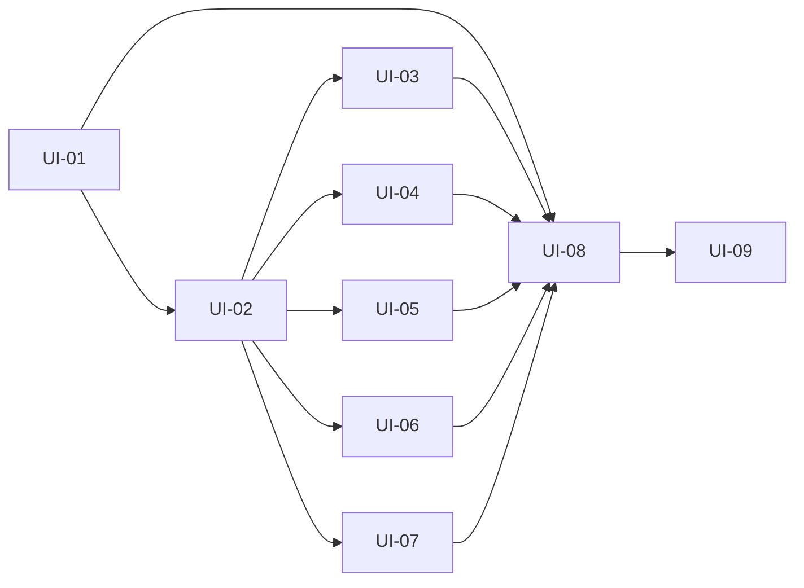

# Sprint 04 — Frontend Foundation & MVP Interactive Prototype: Sprint Planning Report

## 1. Thông tin

- Task ID — Sprint 04 Planning
- Ngày — 2026-11-27
- Trạng thái — COMPLETED (Planning phase)
- Loại — Sprint Planning Report

---

## 2. Repository Assessment

### Sprint Status

| Sprint | Trạng thái | Tóm tắt |
|---|---|---|
| Sprint 01 (Auth) | COMPLETED | 13/13 task. Real APIs: Register, Login, Refresh, Logout. Frontend: Auth UI, session restore, protected routes. |
| Sprint 02 (WS+PROJ) | COMPLETED | 8/8 task. Workspace, Invitation, Project APIs + UI. |
| Sprint 03 (Task+Board) | IN_PROGRESS (6/7) | Task CRUD, Kanban, dnd. TASK-BOARD-INT-01 còn PENDING. |
| Sprint 04 (Frontend) | PENDING | Tạo trong planning session này. |

### Existing Frontend

**Architecture:** Feature-based, React 19 + Vite 8 + TypeScript + Tailwind CSS v4 + shadcn/ui.

**Dependencies đã cài:** React Hook Form, Zod, Lucide React, TanStack Query, React Router v7, Zustand, shadcn/ui (button, input, label, card), class-variance-authority.

**Tests:** 68+ tests (Vitest + RTL), gồm auth, workspace, project, task, board.

**Existing screens (production-ready):** Login, Register, WorkspaceSettings, AcceptInvite, Projects, ProjectSettings, ProjectTasks, ProjectBoard, TaskDetail, MyTasks.

**TODO stubs cần implement:** AppShellLayout, DashboardPage, AiPlannerPage, NotificationsPage, CommentSection, AttachmentUploader, NotificationBell, AiBriefForm, AiPlanDraftEditor.

**Missing screens:** `/settings/profile`, full AppShell wrapper.

### Identified Issues

1. `AppShellLayout.tsx` là TODO stub → không có Sidebar/Header nhất quán
2. 9 màn hình TODO stub trong scope MVP
3. 2 màn hình chưa có file (profile, activity timeline)
4. 12 backend API endpoints chưa implement (COL/NOTI/DASH/AI) → cần mock
5. Recharts và Socket.IO Client chưa được cài
6. Bundle size ~530KB → cần code splitting khi thêm Recharts

---

## 3. Frontend Development Strategy

### Category A — Real API (dùng ngay)

Authentication, Workspace, Project, Task, Board, My Tasks. Tất cả đã có real backend.

### Category B — Mock API (Sprint 04)

Dashboard stats, Notifications, Comments, Attachments, AI Planner.
Mock pattern: `VITE_USE_MOCK_API=true/false` trong `.env`.
Fixtures: `frontend/src/mocks/fixtures/`.

---

## 4. Sprint 04 Summary

**Sprint ID:** Sprint 04  
**Tên:** Frontend Foundation & MVP Interactive Prototype  
**Mục tiêu:** Hoàn thiện Application Shell và mọi màn hình TODO stub trong MVP scope.  
**Effort ước tính:** 9–13 ngày làm việc solo (2–2.5 tuần).  
**Dependencies:** Sprint 03 DoD (TASK-BOARD-INT-01).

### Task Breakdown

| Task ID | Tên | Priority | Effort | Status |
|---|---|---|---|---|
| UI-01 | Application Shell và Navigation | P0 | M (1–2 ngày) | PENDING |
| UI-02 | Shared UI Component Library | P0 | M (1–2 ngày) | PENDING |
| UI-03 | Dashboard UI | P1 | M (1–2 ngày) | PENDING |
| UI-04 | Notification Center UI | P1 | M (1–2 ngày) | PENDING |
| UI-05 | Collaboration UI | P1 | M (1–2 ngày) | PENDING |
| UI-06 | AI Planner UI | P1 | M (1–2 ngày) | PENDING |
| UI-07 | Settings & Profile UI | P2 | S (0.5–1 ngày) | PENDING |
| UI-08 | Design System Consistency Pass | P2 | S (0.5–1 ngày) | PENDING |
| UI-09 | Frontend Foundation Testing & Review | P1 | M (1–2 ngày) | PENDING |

### Execution Order

---

## 5. Screen Inventory Summary

32 màn hình trong scope MVP:
- 18 ✅ REAL (production-ready)
- 3 🟡 MOCK (prototype, có cấu trúc)
- 9 🔴 STUB (TODO, Sprint 04 target)
- 2 ⬜ MISSING (Sprint 04 target)

Xem đầy đủ tại [docs/design/screen-inventory.md](../design/screen-inventory.md).

---

## 6. API Readiness Summary

20 endpoints REAL, 12 endpoints MOCK required.
Xem đầy đủ tại [docs/design/api-readiness-matrix.md](../design/api-readiness-matrix.md).

---

## 7. Files tạo / cập nhật

| File | Action |
|---|---|
| `docs/sprints/sprint-04-frontend-foundation/README.md` | Tạo |
| `docs/sprints/sprint-04-frontend-foundation/tasks/UI-01-application-shell.md` | Tạo |
| `docs/sprints/sprint-04-frontend-foundation/tasks/UI-02-shared-components.md` | Tạo |
| `docs/sprints/sprint-04-frontend-foundation/tasks/UI-03-dashboard-ui.md` | Tạo |
| `docs/sprints/sprint-04-frontend-foundation/tasks/UI-04-notification-ui.md` | Tạo |
| `docs/sprints/sprint-04-frontend-foundation/tasks/UI-05-collaboration-ui.md` | Tạo |
| `docs/sprints/sprint-04-frontend-foundation/tasks/UI-06-ai-planner-ui.md` | Tạo |
| `docs/sprints/sprint-04-frontend-foundation/tasks/UI-07-settings-profile-ui.md` | Tạo |
| `docs/sprints/sprint-04-frontend-foundation/tasks/UI-08-design-system-pass.md` | Tạo |
| `docs/sprints/sprint-04-frontend-foundation/tasks/UI-09-testing-review.md` | Tạo |
| `docs/design/screen-inventory.md` | Tạo |
| `docs/design/api-readiness-matrix.md` | Tạo |
| `docs/design/navigation-map.md` | Tạo |
| `docs/sprints/README.md` | Cập nhật (thêm Sprint 04) |
| `AGENTS.md` | Cập nhật (thêm Frontend Architecture rules) |
| `docs/reports/frontend/sprint-04-planning.md` | Tạo |

---

## 8. Risks và Blockers

| Risk | Mức | Giải pháp |
|---|---|---|
| Sprint 03 TASK-BOARD-INT-01 còn PENDING | Medium | Chờ DoD Sprint 03 trước khi bắt đầu Sprint 04 |
| Backend COL/NOTI/DASH/AI chưa có | High (known) | Mock API rõ ràng, dễ swap khi backend ready |
| Bundle size ~530KB | Low | Code splitting khi cài Recharts/Socket.IO |
| Socket.IO real-time Notifications | Medium | Fallback sang polling 30s, enable real-time ở Sprint 05 |

---

## 9. Recommended First Task

**UI-01 — Application Shell và Navigation**  
Task Spec: `docs/sprints/sprint-04-frontend-foundation/tasks/UI-01-application-shell.md`

**Điều kiện bắt đầu:**
- Sprint 03 TASK-BOARD-INT-01 phải COMPLETED
- Backend đang chạy với `VITE_API_BASE_URL` đúng

**Lý do chọn UI-01 đầu tiên:** AppShellLayout là blocker cho tất cả các màn hình protected khác. Khi Shell xong, UI-02 đến UI-07 có thể thực hiện độc lập song song.
