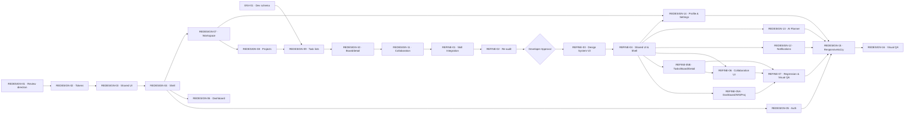

# Task Dependency Graph

ENV-01 có thể thực hiện độc lập sau khi phê duyệt môi trường. Nhánh `REFINE-03` → `REFINE-07` là cổng refinement (chờ Developer Approval) trước khi đóng các màn còn lại `REDESIGN-12..16`. Thứ tự quản lý theo [Sprint Backlog](README.md) và [Sprint 08](../sprint-08-frontend-collaboration-quality/README.md).
